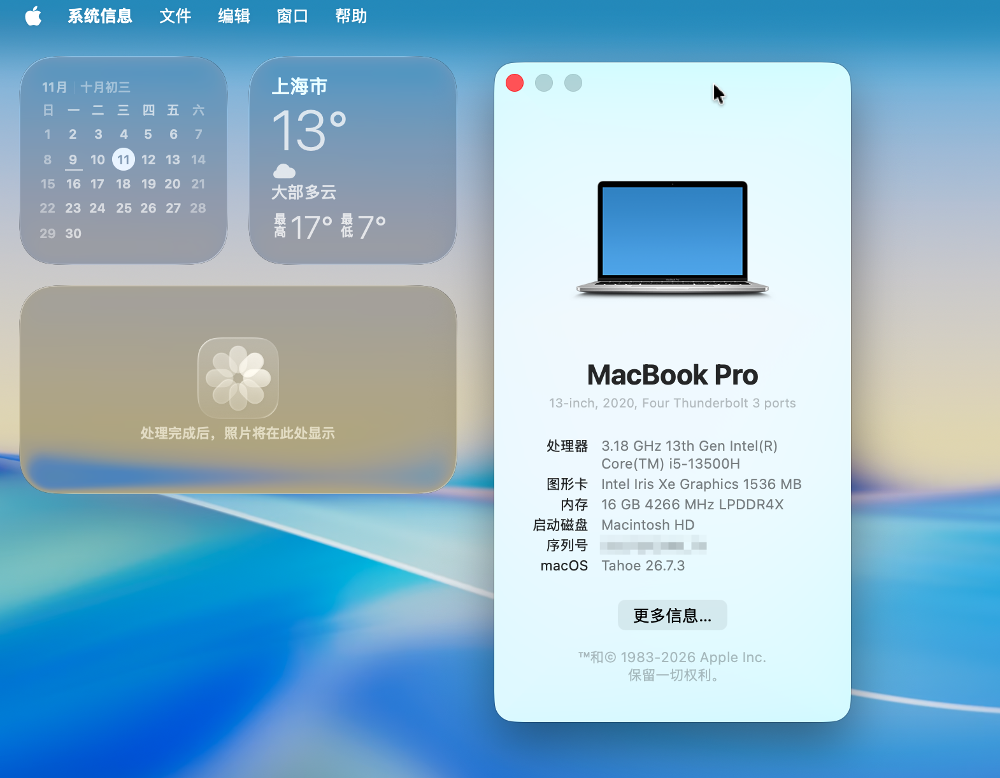
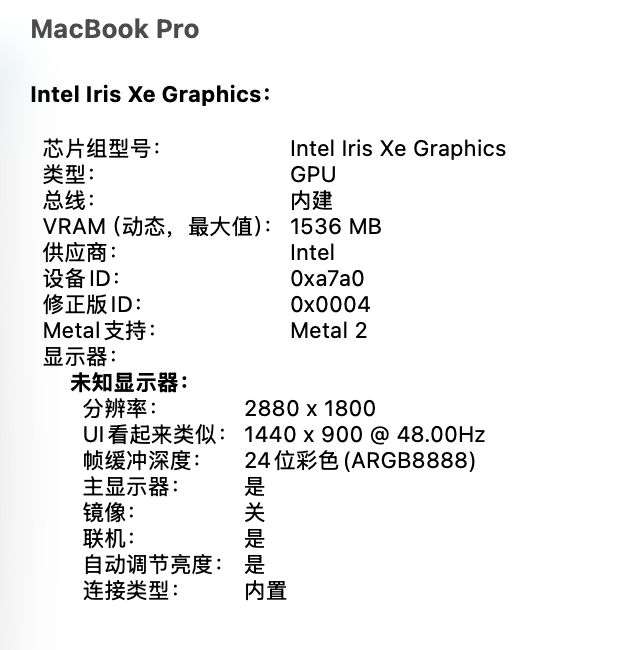
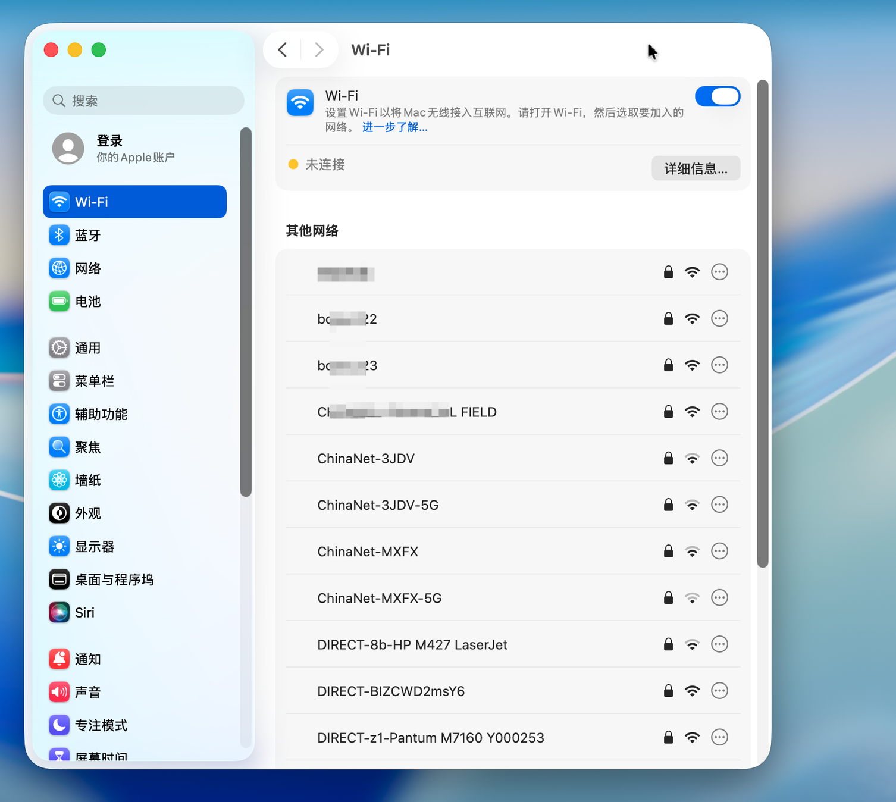
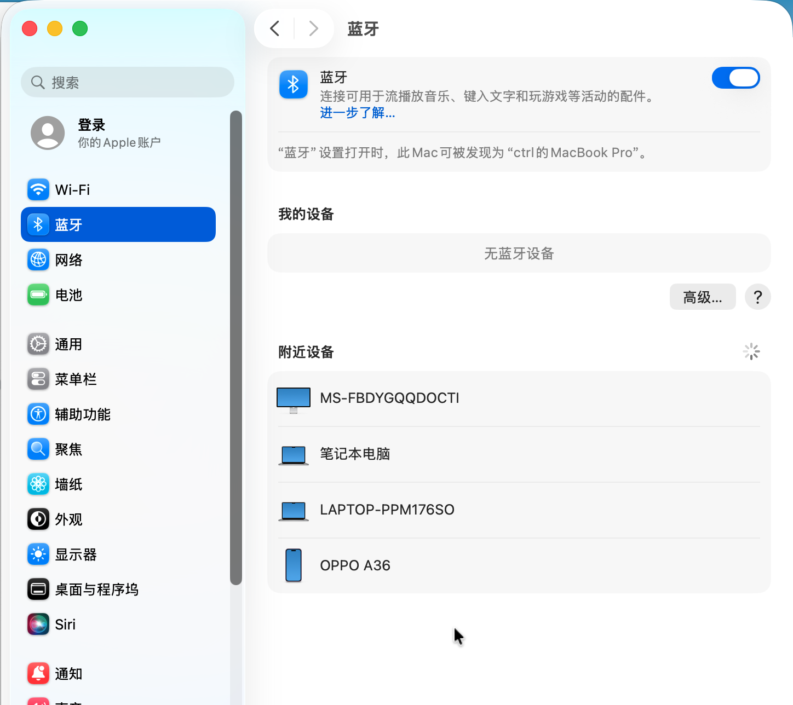
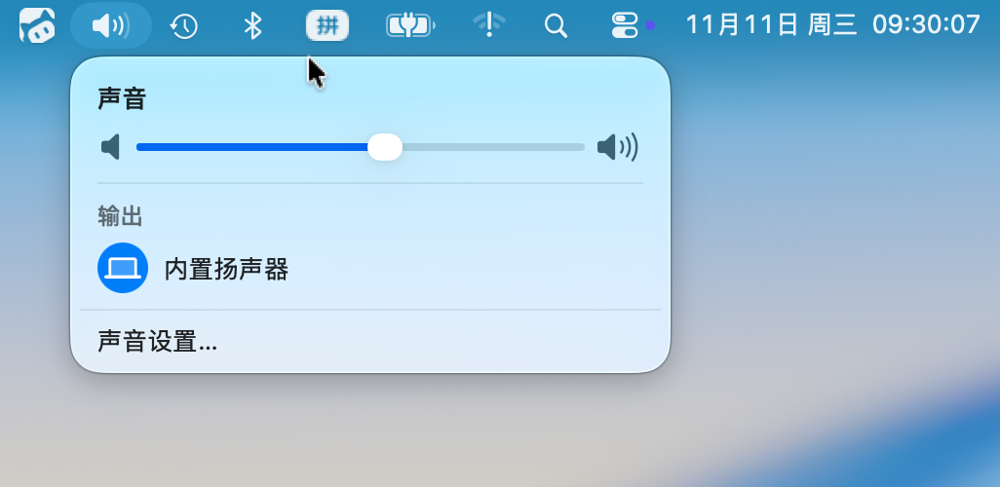
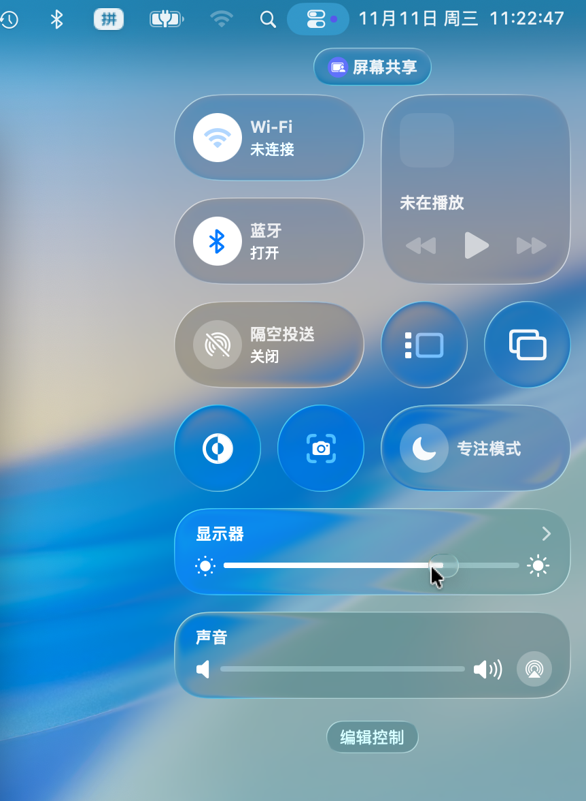

# OpenCore for Honor MagicBook X16 Pro (BRN-G561)

本 EFI 基于Github开源项目整理调试。适用于 **荣耀 MagicBook X16 Pro（产品型号 BRN-G561）** 的 OpenCore 黑苹果 EFI，已在 **macOS Tahoe 26.7.3** 上实测可用。核显、Wi-Fi、蓝牙、声卡、亮度调节、电池、触摸板等日常功能均可正常工作，适合想在这台机器上体验 macOS 的朋友参考使用。

> ⚠️ 黑苹果仅用于学习与交流，请遵守 macOS 软件许可协议，勿用于商业用途。

## 设备配置

| 项目 | 规格 |
| --- | --- |
| 型号 | Honor MagicBook X16 Pro（BRN-G561） |
| 处理器 | Intel Core i5-13500H（Raptor Lake-H，4P + 8E / 16 线程） |
| 显卡 | Intel® Iris® Xe Graphics（仿冒驱动，支持 Metal 2） |
| 内存 | 16 GB LPDDR4X 4266 MHz |
| 屏幕 | 16 英寸 2880 × 1800 |
| 存储 | NVMe SSD |
| 无线 | Intel Wi-Fi + 蓝牙（OpenIntelWireless 驱动） |
| SMBIOS | MacBookPro16,2 |

## 功能状态

| 功能 | 状态 | 说明 |
| --- | --- | --- |
| CPU 电源管理 / 变频 | ✅ | SSDT-PLUG-ALT + CpuTopologyRebuild（大小核拓扑优化） |
| 核显加速 | ✅ | WhateverGreen 仿冒，Metal 正常|
| 屏幕亮度调节 / 自动亮度 | ✅ | BrightnessKeys + SMCLightSensor + SSDT-PNLF / ALS0 |
| 声卡 / 内置扬声器 | ✅ | AppleALC|
| Wi-Fi | ✅ | AirportItlwm|
| 蓝牙 | ✅ | IntelBluetoothFirmware + IntelBTPatcher + BlueToolFixup |
| 电池电量显示 | ✅ | SMCBatteryManager |
| 触摸板（多指手势） | ✅ | VoodooI2C + VoodooI2CHID |
| 键盘 | ✅ | VoodooPS2Controller |
| USB 端口 | ✅ | USBToolBox + UTBDefault 定制 |
| NVMe 电源管理 | ✅ | NVMeFix |
| 指纹识别 | ❌ | 硬件无 macOS 驱动，不可用 |

## 截图

### 关于本机

### 显卡（Metal / 分辨率 / 自动亮度）

### Wi-Fi

### 蓝牙

### 声音输出

### 亮度调节

## 免责声明

- 本项目仅供学习交流，不提供任何担保；刷写 / 使用 EFI 存在风险，操作前请备份重要数据与原有 EFI。
- macOS 的软件许可协议仅允许在 Apple 硬件上安装使用，请在了解相关法律与许可条款后自行决定是否使用。
- 如有侵权或问题，请提 Issue 联系处理。